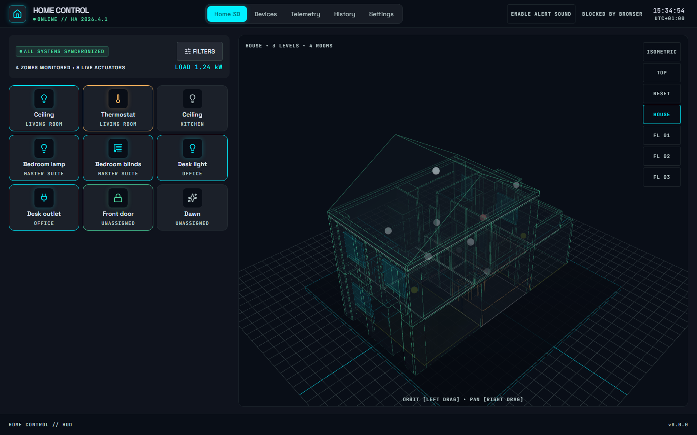
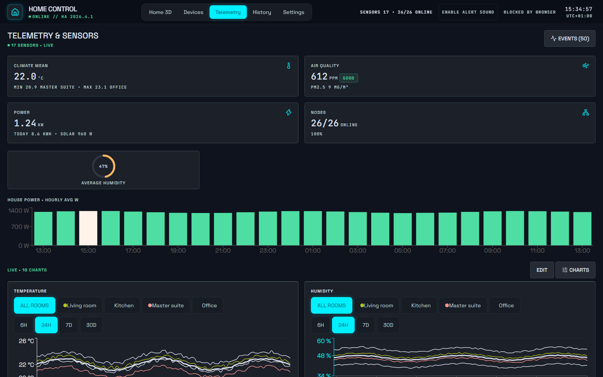

# Home Control Frontend

A self-hosted smart-home control panel: a 3D house view, device control, live telemetry and alerts, shipped as a web app and an Electron desktop shell.

[](https://react.dev)
[](https://vite.dev)
[](https://tailwindcss.com)
[](https://www.typescriptlang.org)
[](https://playwright.dev)

## Screenshots





<sub>Captured from the mock API (`npm run dev`, `?mock=default`).</sub>

## Features

- **3D house view**: a lazily loaded three.js scene of the home, with rooms and devices placed from a floor plan.
- **Device control**: lights, switches, covers (with calibration and saved positions), climate, preset modes, zones and display-name aliases.
- **Live telemetry**: sensor charts with configurable widgets and filters, updated in real time as the backend pushes events.
- **History**: per-entity history view backed by the backend history API.
- **Alerts**: alert rules with severity levels, a local rule engine, server-side alerts and optional system notifications.
- **Event feed and link status**: recent events and backend / Home Assistant link state in the header.
- **Desktop shell (Electron)**: opens the panel in a window, keeps running in the system tray, remembers window size and can start at login. The panel URL is configurable.
- **Mock mode**: a built-in mock API with named scenarios (empty, error, slow, offline, alerts, and more) so the UI can be developed and tested without a backend.

## Tech stack

| Area | Tools |
| --- | --- |
| UI | React 19, React Router 7, Tailwind CSS 4, lucide-react |
| Charts and 3D | Recharts, three.js (lazy-loaded chunk) |
| Build | Vite 8, TypeScript, `@vitejs/plugin-react` |
| Testing | Vitest, Testing Library, jsdom, Playwright (E2E, separate repo) |
| Lint | oxlint, custom design-token lint |
| Desktop | Electron, electron-builder (NSIS for Windows) |
| Delivery | Multi-stage Dockerfile (Node build, nginx runtime) |

## Architecture and project structure

```
src/
  api/         HomeApi contract, live (HTTP + server events) and mock implementations
  features/    domain logic: alerts, telemetry, devices, covers, calibration, history, presets, zones
  components/  UI building blocks (cards, controls, dropdowns, panels, feedback)
  house/       3D house scene, floor plan and device glow
  pages/       route-level pages (home, devices, device detail, telemetry, history, settings)
  layouts/     app shell and navigation
electron/      Electron main, preload and pure helpers (tested with Vitest)
scripts/       build checks (bundle guard, design-token lint) and CAD plan export helpers
```

The app talks to a backend through a single `HomeApi` interface. `VITE_API_MODE` selects either the live implementation or the mock; mock code is excluded from production bundles.

## Getting started

### Prerequisites

- Node.js 22 or newer
- npm

### Install

```bash
git clone https://github.com/hectorrdez/home-control-frontend.git
cd home-control-frontend
npm install
cp .env.example .env
```

### Configuration

All configuration is read from `.env` (never commit it). See [`.env.example`](.env.example).

| Variable | Purpose |
| --- | --- |
| `VITE_API_URL` | Backend base URL. Empty means same origin. |
| `VITE_API_TOKEN` | Bearer token sent on every `/api` request. Bundled into the client, so the panel must stay private. |
| `VITE_API_MODE` | `live` or `mock`. Unset: `mock` in development, `live` in production builds. |
| `VITE_PROXY_TARGET` | Backend the Vite dev server proxies `/api` to (default `http://localhost:3003`). |

Electron reads `HC_PANEL_URL` (panel URL to load) and `HC_DATA_DIR` (config and window state directory) from the environment.

### Run it

```bash
npm run dev          # Vite dev server (mock mode by default)
```

Open the printed URL. Add `?mock=<scenario>` to pick a mock scenario, for example `?mock=alerts` or `?mock=offline`.

### Scripts

| Script | Description |
| --- | --- |
| `npm run dev` | Start the Vite dev server |
| `npm run dev:host` | Dev server exposed on the local network |
| `npm run build` | Typecheck (`tsc -b`) and production build |
| `npm run preview` | Serve the production build locally |
| `npm run lint` | oxlint plus the design-token lint |
| `npm run test:unit` | Run the Vitest suite |
| `npm run test:unit:cov` | Unit tests with V8 coverage |
| `npm run electron:dev` | Run the Electron shell against the dev server (`--dev`) |
| `npm run electron:build` | Package the Windows installer with electron-builder |

### Docker

```bash
VITE_API_TOKEN=your-token docker compose up --build
```

The image builds the app with the `VITE_*` build args and serves `dist/` with nginx on `$PORT` (default 8080, SPA fallback and `/healthz`). `VITE_API_TOKEN` is baked into the bundle at build time.

## Testing

- **Unit and component tests** live next to the source (`*.test.ts(x)`, `electron/*.test.mjs`, `scripts/**/*.test.mjs`) and run with `npm run test:unit`.
- **End-to-end tests** (Playwright) run in mock mode against this app's dev server, selecting scenarios with `?mock=`, and can point at a deployed panel for read-only smoke checks. The suite is maintained in a separate private repository.

```bash
# In the testing repository, with this repository checked out next to it
FRONTEND_DIR=../home-control-frontend npm test
```

## Related projects

- Backend: [home-control-backend](https://github.com/hectorrdez/home-control-backend), the API this panel talks to.

